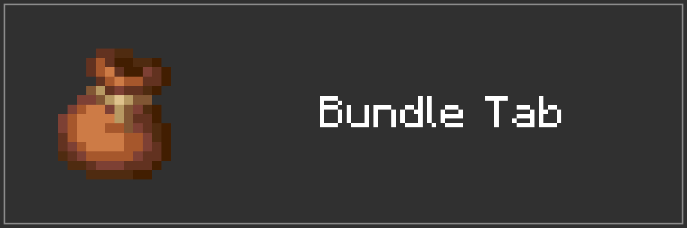
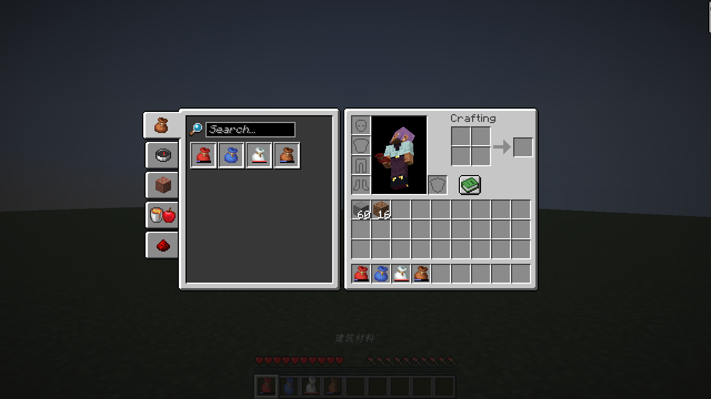

# Bundle Tab

Browse your bundles in the vanilla recipe book. The bundle tab appears first and opens with your inventory. Also works at crafting tables, with no server mod required.

[Watch the Bundle Tab demo on YouTube](https://youtu.be/O019rSL0x2o).



Search by item name, ID, or Pinyin, and click a bundle to browse its contents.

| Action | Result |
| --- | --- |
| Drop held items onto the bundle list | Store in the first matching bundle with space |
| Drop held items onto a bundle | Store in that bundle |
| Click an item inside a bundle | Take out the selected stack |
| Click inside a bundle while holding items | Store the held items |
| Shift-click an item inside a bundle | Move it to your inventory |
| Space + left-click an inventory item | Store it in the selected bundle, or the first available bundle |

Items that do not fit stay where they are. Mouse Tweaks gestures inside the bundle panel are not supported.

## Installation

Supports Minecraft 1.21.11, 26.1, 26.1.1, 26.1.2, 26.2, and 26.3. Requires Fabric Loader 0.19.5 or newer.
Download the jar matching your Minecraft version from [Releases](https://github.com/PluginsKers/bundle-tab/releases) and place it in your client's `mods` folder. Use Java 21 for 1.21.11 and Java 25 for 26.x. Remove older Better Bundle or Bundle Tab jars first; the mod ID remains `better-bundle`.

## Building

```sh
./gradlew build
./gradlew :26.3:runClientGameTest
```

Use `gradlew.bat` on Windows. Run Gradle with JDK 25; the Java 21 toolchain is downloaded when needed. Game tests require a display. `build` builds all versions; `:1.21.11:build` builds one. Jars are written to `versions/<minecraft>/build/libs`.
Game tests include the matching Mouse Tweaks release.

## Credits and license

Based on [BetterBundleHUDMod](https://github.com/zeroowo24/BetterBundleHUDMod) by zeroowo24. Maintained by PluginsKers under [CC0-1.0](LICENSE). Bundled pinyin4j retains its own license.

The logo and banner use Minecraft artwork by Mojang Studios.
